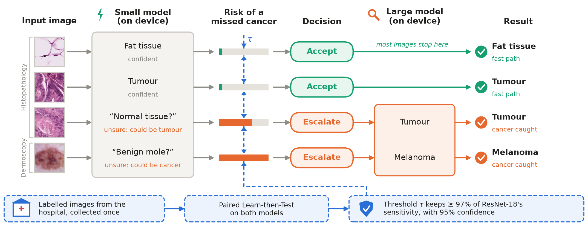

# Sensitivity-Constrained Model Cascades for Medical Image Classification on Edge Devices

A small model (MobileNetV3-Small) classifies every medical image on the device; images it might get dangerously
wrong are escalated to a large model (ResNet-18). The escalation threshold is chosen with a statistical guarantee
that the cascade keeps at least a fraction α of ResNet-18's sensitivity (cancer detection rate), and the whole
system is benchmarked on an x86 PC and on the CPU of an Android phone.

Paper: [`paper/main.tex`](paper/main.tex) (IEEE conference format). All numbers in the paper come from the files
in [`results/`](results/) and [`paper/figures/`](paper/figures/); [`paper/RESULTS.md`](paper/RESULTS.md) lists
every finding with its source.



## Main results

| Finding | Number |
|---|---|
| Miss-risk routing vs. softmax confidence, PathMNIST, 97% floor | 1.2% vs. 4.8% of images escalated |
| AUROC for finding missed positives, HAM10000 | 0.89 vs. 0.61 |
| Thresholds calibrated on source data under cohort shift | floor met in 1 of 3 seeds |
| Naive INT8 quantisation of Stage 1 | cascade sensitivity falls to 6.7% (mixed precision restores it) |
| Measured vs. FLOP-predicted speed-up (1 thread) | 12.5× (x86) and 8.9× (phone) vs. 27.9× |
| Two models, four phone cores, default threads | cascade up to 179% slower than predicted |

## Repository layout

| Path | Contents |
|---|---|
| `cascade/data.py` | PathMNIST (MedMNIST+, 128 px) and HAM10000 (lesion-level split) loaders |
| `cascade/models.py`, `cascade/train.py` | MobileNetV3-Small / ResNet-18, GPU training, logit dumps |
| `cascade/signals.py` | Routing signals (MSP, entropy, margin, temperature-scaled, **miss-risk**), temperature scaling, ECE |
| `cascade/routing.py`, `cascade/stats.py` | Cascade curves, plug-in and **paired Learn-then-Test** threshold selection, Clopper–Pearson, bootstrap |
| `cascade/analyze.py`, `cascade/report.py` | Full offline analysis (source and target calibration) and markdown reports |
| `cascade/deploy.py` | ONNX export, static INT8 and mixed-precision quantisation, deployable cascade configs |
| `cascade/figures.py`, `scripts/make_pipeline_figure.py` | Paper figures and tables |
| `edge_bench/` | Standalone on-device benchmark (needs only numpy + onnxruntime) |
| `scripts/` | Training, analysis and benchmarking drivers |
| `results/` | Analysis outputs (3 seeds) and device benchmarks (`results/bench/`) |
| `paper/` | IEEE paper, bibliography, figures, results summary |
| `proposal/` | Project proposal |

## Reproducing

```powershell
py -3.13 -m venv .venv
.\.venv\Scripts\python.exe -m pip install torch torchvision --index-url https://download.pytorch.org/whl/cu128
.\.venv\Scripts\python.exe -m pip install -r requirements.txt

# 1. Train 3 seeds x 2 models per dataset (PathMNIST downloads automatically; HAM10000 see below)
powershell -ExecutionPolicy Bypass -File scripts\train_all.ps1 -Dataset pathmnist
powershell -ExecutionPolicy Bypass -File scripts\train_all.ps1 -Dataset ham10000
powershell -ExecutionPolicy Bypass -File scripts\train_all.ps1 -Dataset ham10000bal   # class-balanced variant

# 2. ONNX export + INT8 for every seed, then all analyses and device configs
foreach ($d in "pathmnist","ham10000") { foreach ($s in 0,1,2) { .\.venv\Scripts\python.exe -m cascade.deploy export --dataset $d --seed $s } }
sh scripts/analyze_all.sh            # Git Bash

# 3. Benchmarks and figures
powershell -ExecutionPolicy Bypass -File scripts\bench_pc.ps1
.\.venv\Scripts\python.exe -m cascade.figures
.\.venv\Scripts\python.exe scripts\make_pipeline_figure.py
```

### Checking the paper against the results

`scripts/verify_paper.py` recomputes every number quoted in the paper (252 checks) from the committed files in
`results/` and prints PASS/FAIL; the last run is saved in `results/verify_paper_output.txt`.
`scripts/quant_sensitivity.py` reproduces the per-block INT8 analysis behind the mixed-precision model, and
`scripts/export_evidence.py` refreshes `results/evidence/` (training logs, model sizes, dataset counts) after retraining.

```powershell
.\.venv\Scripts\python.exe scripts\verify_paper.py
```

HAM10000: download from Harvard Dataverse (doi:10.7910/DVN/DBW86T) and unzip the two image archives and
`HAM10000_metadata.tab` into `data/ham10000/`.

### Running the benchmark on a phone (Android, Termux)

`scripts/make_bundle.py` packs `edge_bench/` and the seed-0 models into `bench_bundle.zip`. On the phone, inside
Termux + `proot-distro` Ubuntu with Python 3.12 (`uv venv --python 3.12`, then `uv pip install numpy onnxruntime psutil`):

```sh
taskset -c 4-7 sh edge_bench/run_matrix.sh deploy/pathmnist_128_seed0 android "1 2 4"
taskset -c 4-7 sh edge_bench/run_matrix.sh deploy/pathmnist_128_seed0 android "4" --no-spin
taskset -c 0-3 sh edge_bench/run_matrix.sh deploy/pathmnist_128_seed0 android_little "1"
```

(On the Snapdragon 662, cores 4–7 are Kryo 260 Gold and 0–3 Kryo 260 Silver; check with
`grep -E "processor|CPU part" /proc/cpuinfo`.)

## Hardware used

- Training and x86 benchmark: AMD Ryzen 7 7700, NVIDIA RTX 5070 (12 GB), Windows 11
- ARM benchmark: Oppo F19 (Snapdragon 662, Android 13), Termux + proot Ubuntu, ONNX Runtime 1.31.1

## Development note

The project was developed locally between late October and mid-November 2026 and imported into this repository at
submission time, organised into one commit per component. Work done after the import is committed as it happens.
The actual order of the work, the evidence for each step and the module owners are in
[`docs/DEVELOPMENT_TIMELINE.md`](docs/DEVELOPMENT_TIMELINE.md).
